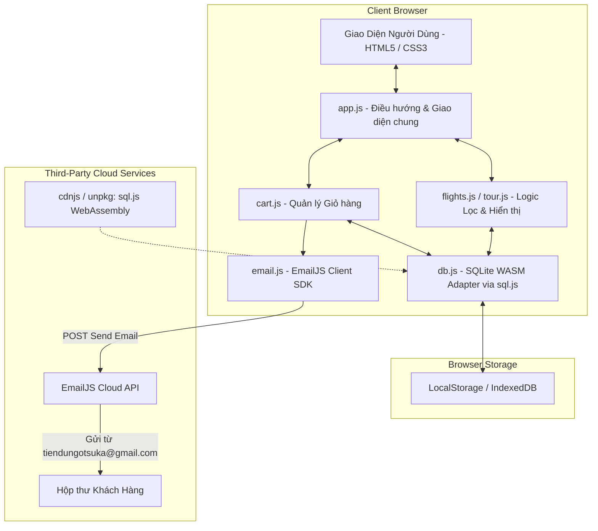

# ARCHITECTURE.md - KIẾN TRÚC KỸ THUẬT & TÍCH HỢP HỆ THỐNG
## DỰ ÁN: VIETJET TRAVEL & BOOKING (NO-BACKEND CLIENT ARCHITECTURE)

---

## 1. TỔNG QUAN KIẾN TRÚC KỸ THUẬT

Dự án được xây dựng theo mô hình **Zero-Backend Single Page & Multi-Page Hybrid** hoàn toàn bằng công nghệ Web chuẩn (HTML5, CSS3, Vanilla JavaScript ES6+).



---

## 2. CẤU TRÚC THƯ MỤC DỰ ÁN (PROJECT DIRECTORY TREE)

```text
d:\VietJet_TD\
│
├── Images/                    # Thư mục hình ảnh logo có sẵn
│   ├── vietjet-air.png        # Logo VietJet Air chính hãng
│   ├── vietnam-airlines.png   # Logo Vietnam Airlines
│   └── singapore-airline.png  # Logo Singapore Airlines
├── SQLLITE/                   # Thư mục lưu trữ database SQLite (.sqlite / .db export)
├── index.html                 # Trang chủ: Hero tìm vé, 8 tour nổi bật, đối tác hàng không
├── flights.html               # Trang danh sách chuyến bay & bộ lọc đa tiêu chí
├── flight-detail.html         # Trang chi tiết chuyến bay & lựa chọn hạng vé
├── tour.html                  # Trang danh sách tour du lịch & bộ lọc
├── tour-detail.html           # Trang chi tiết tour du lịch, lịch trình & đặt tour
├── cart.html                  # Trang giỏ hàng, thông tin khách hàng & hoàn tất đặt chỗ
│
├── css/
│   ├── variables.css          # Định nghĩa biến màu (#ee1d23), font chữ, shadow, spacing
│   ├── base.css               # Reset CSS, typography, container, utility classes
│   ├── components.css         # Style các component: button, input, badge, modal, toast
│   ├── header-footer.css      # Style thanh điều hướng (navbar) và chân trang (footer)
│   ├── pages.css              # Style đặc thù cho từng trang (home, flights, tours, cart)
│   └── responsive.css         # Media queries tối ưu cho tablet và mobile
│
├── js/
│   ├── db.js                  # Khởi tạo SQLite WASM (sql.js), DDL, nạp dữ liệu mẫu, query helper
│   ├── app.js                 # Xử lý chung: menu mobile, badge giỏ hàng, toast notification
│   ├── flights.js             # Logic lọc chuyến bay (giá, giờ bay, hãng), URL params parser
│   ├── tour.js                # Logic lọc danh sách tour du lịch
│   ├── cart.js                # Quản lý mảng giỏ hàng, tính tổng tiền, xóa item
│   └── email.js               # Tích hợp EmailJS SDK gửi email từ tiendungotsuka@gmail.com
│
├── assets/
│   ├── images/
│   │   ├── logo/              # Logo VietJet, Vietnam Airlines, Bamboo, Singapore Airlines...
│   │   ├── banners/           # Hero banner, background du lịch
│   │   └── tours/             # 8 ảnh thumbnail chất lượng cao 600x400
│   └── icons/                 # SVG icons máy bay, vali, đồng hồ, lịch, giỏ hàng
│
├── PRD.md                     # Tài liệu đặc tả yêu cầu sản phẩm chi tiết
├── DATABASE_SCHEMA.md         # Thiết kế bảng SQLite, DDL & DML khởi tạo
├── UI_UX_SPEC.md              # Bảng quy chuẩn giao diện, màu sắc, typography
├── ARCHITECTURE.md            # Tài liệu kiến trúc kỹ thuật này
├── IMPLEMENTATION_PLAN.md     # Kế hoạch từng bước triển khai tự động bằng Antigravity
└── README.md                  # Hướng dẫn tổng quan & khởi chạy nhanh dự án
```

---

## 3. GIẢI PHÁP GỬI EMAIL TỰ ĐỘNG KHÔNG CẦN BACKEND (EMAILJS)

### 3.1. Bài toán & Lựa chọn công nghệ
Yêu cầu của dự án:
> *"Một email gửi từ tiendungotsuka@gmail đến email của khách hàng."*
> *Đặc thù: Không có backend server.*

**Giải pháp tối ưu nhất hiện nay:** Sử dụng dịch vụ **EmailJS (`https://www.emailjs.com/`)**.
* Cho phép gọi trực tiếp từ JavaScript trong trình duyệt thông qua CDN:
  `<script src="https://cdn.jsdelivr.net/npm/@emailjs/browser@3/dist/email.min.js"></script>`
* Kết nối bảo mật tới hòm thư Gmail `tiendungotsuka@gmail.com` qua giao thức OAuth2 an toàn của Google.
* Tự động điền dữ liệu động vào mẫu email (Mã PNR, Tên khách hàng, Chuyến bay, Tour, Tổng tiền).

### 3.2. Cấu trúc Module `email.js`

```javascript
/**
 * email.js - Tích hợp gửi email xác nhận đặt vé từ tiendungotsuka@gmail.com
 */
const EMAIL_CONFIG = {
    // Có thể cấu hình Public Key từ tài khoản EmailJS
    PUBLIC_KEY: 'YOUR_EMAILJS_PUBLIC_KEY',
    SERVICE_ID: 'vietjet_gmail_service',
    TEMPLATE_ID: 'booking_confirm_template',
    ADMIN_EMAIL: 'tiendungotsuka@gmail.com'
};

// Khởi tạo EmailJS
(function initEmail() {
    if (window.emailjs && EMAIL_CONFIG.PUBLIC_KEY !== 'YOUR_EMAILJS_PUBLIC_KEY') {
        emailjs.init(EMAIL_CONFIG.PUBLIC_KEY);
    }
})();

/**
 * Gửi email xác nhận đặt chỗ cho khách hàng
 * @param {Object} bookingData - Thông tin đơn hàng và khách hàng
 */
async function sendBookingConfirmationEmail(bookingData) {
    const templateParams = {
        to_email: bookingData.customer_email,
        to_name: bookingData.customer_name,
        from_email: EMAIL_CONFIG.ADMIN_EMAIL,
        booking_code: bookingData.booking_code,
        booking_phone: bookingData.customer_phone,
        booking_items_summary: bookingData.itemsSummaryHtml,
        total_amount: bookingData.total_amount.toLocaleString('vi-VN') + ' ₫',
        booking_date: new Date().toLocaleDateString('vi-VN'),
        support_hotline: '1900 1886'
    };

    console.log('[Email Service] Đang gửi xác nhận từ:', EMAIL_CONFIG.ADMIN_EMAIL, 'tới:', bookingData.customer_email);

    try {
        if (window.emailjs && EMAIL_CONFIG.PUBLIC_KEY !== 'YOUR_EMAILJS_PUBLIC_KEY') {
            const response = await emailjs.send(
                EMAIL_CONFIG.SERVICE_ID,
                EMAIL_CONFIG.TEMPLATE_ID,
                templateParams
            );
            console.log('[Email Service] Gửi email thành công!', response.status, response.text);
            return { success: true, mode: 'real', response };
        } else {
            // Chế độ mô phỏng thông minh (Simulation Mode) khi chưa điền API Key thực tế
            console.info('[Email Service - Giả Lập] Đã tạo thành công thư điện tử gửi từ ' + EMAIL_CONFIG.ADMIN_EMAIL);
            return {
                success: true,
                mode: 'simulation',
                message: `Email xác nhận đã được gửi thành công từ ${EMAIL_CONFIG.ADMIN_EMAIL} tới ${bookingData.customer_email}!`
            };
        }
    } catch (error) {
        console.error('[Email Service Error]', error);
        return { success: false, error };
    }
}
```

---

## 4. CHI TIẾT CƠ CHẾ ĐIỀU PHỐI DỮ LIỆU & TRẠNG THÁI (STATE MANAGEMENT)

### 4.1. Luồng dữ liệu tìm kiếm và lọc:
1. Tại `index.html`: Form tìm kiếm đóng gói tham số vào Query String:
   `flights.html?from=SGN&to=HAN&date=2026-11-20&type=roundtrip`
2. Tại `flights.html`: Script `flights.js` phân tích URL Search Params:
   * Chuyển các tham số thành điều kiện `WHERE` trong câu lệnh SQL gửi tới `dbApp.query(...)`.
   * Ví dụ:
     ```sql
     SELECT f.*, a.name AS airline_name, a.logo_url AS airline_logo
     FROM flights f
     JOIN airlines a ON f.airline_id = a.id
     WHERE (f.departure_code = 'SGN' OR 'SGN' = '')
       AND (f.destination_code = 'HAN' OR 'HAN' = '')
     ORDER BY f.price_economy ASC;
     ```
3. Khi người dùng tick các ô filter bên cột trái (Hãng bay, Giờ bay, Hạng vé):
   * Sự kiện `change` kích hoạt hàm lọc lại danh sách trong RAM hoặc tái truy vấn SQLite.
   * Render lại danh sách thẻ chuyến bay mượt mà không cần tải lại toàn bộ trang (AJAX style).

### 4.2. Luồng Quản Lý Giỏ Hàng (`cart.js`):
* Cấu trúc một đối tượng trong giỏ hàng:
  ```json
  {
    "id": 1,
    "item_type": "flight",
    "reference_id": 1,
    "title": "Vé máy bay TP.HCM (SGN) - Hà Nội (HAN)",
    "flight_number": "VJ-124",
    "airline_name": "VietJet Air",
    "ticket_class": "economy",
    "departure_time": "06:00",
    "flight_duration": "2h 10m",
    "aircraft_type": "Airbus A321neo",
    "price": 1250000,
    "quantity": 1
  }
  ```
* Sau mỗi lần Thêm / Xóa:
  * Cập nhật `localStorage.setItem('vietjet_cart', JSON.stringify(cartItems))`.
  * Cập nhật số đếm trên biểu tượng giỏ hàng ở thanh Navigation (`badge.textContent = cartItems.length`).
  * Đồng bộ vào bảng `cart_items` của SQLite trong trình duyệt.

---

## 5. BẢO MẬT & TỐI ƯU TRÊN CLIENT-SIDE
1. **Kiểm tra dữ liệu nhập liệu (XSS Prevention):**
   * Làm sạch và escape toàn bộ chuỗi nhập từ người dùng trước khi hiển thị ra DOM (`textContent` thay vì `innerHTML` đối với dữ liệu từ khách hàng).
2. **Xử lý số tiền và tính toán:**
   * Không lưu tổng tiền dưới dạng chuỗi; luôn tính toán dựa trên số nguyên (`Integer`) đơn vị Đồng để tránh sai số thập phân.
3. **Tải tài nguyên mượt mà:**
   * Sử dụng ảnh thumbnail nén dung lượng cao từ CDN Unsplash với tham số tối ưu (`w=600&h=400&fit=crop&q=80`).
   * Sử dụng Font Awesome hoặc SVG Icons nội tuyến nhẹ nhàng, không làm chậm tốc độ tải trang.
