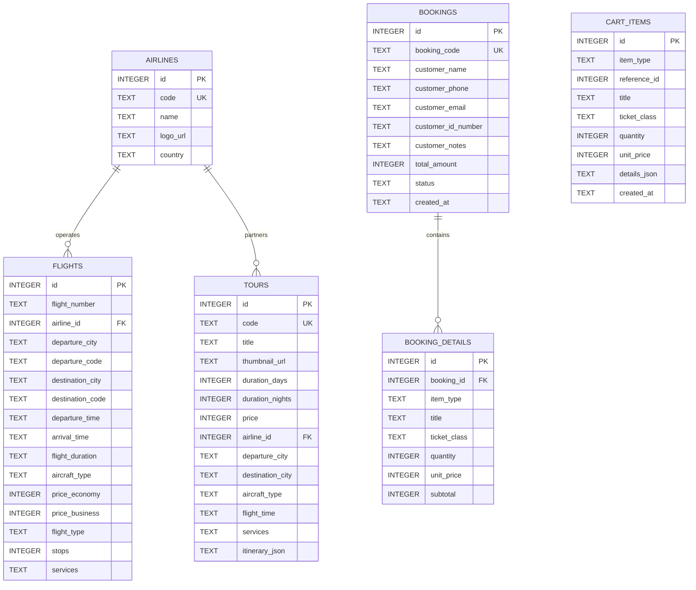

# DATABASE_SCHEMA.md - THIẾT KẾ CƠ SỞ DỮ LIỆU SQLITE (CLIENT-SIDE WASM)
## DỰ ÁN: VIETJET TRAVEL & BOOKING

---

## 1. GIẢI PHÁP KỸ THUẬT SQLITE TRÊN TRÌNH DUYỆT (NO-BACKEND)

Do dự án vận hành **không có backend**, cơ sở dữ liệu **SQLite** được tích hợp và thực thi trực tiếp trên trình duyệt người dùng thông qua thư viện **`sql.js` (SQLite biên dịch sang WebAssembly)**.

### Cơ chế hoạt động:
1. **Khởi tạo:** Khi người dùng truy cập trang web, thư viện `sql.js` tải file WASM (`sql-wasm.wasm`).
2. **Nạp & Phục hồi:** Kiểm tra trong `localStorage` hoặc `IndexedDB` xem đã có file database `.sqlite` (dưới dạng Base64 / ArrayBuffer) chưa:
   * Nếu đã có: Khôi phục trạng thái database hiện hữu.
   * Nếu chưa có (Lần đầu mở web): Tạo database mới trong bộ nhớ, tự động chạy toàn bộ DDL (tạo bảng) và DML (chèn dữ liệu mẫu 8 tour, chuyến bay, hãng hàng không).
3. **Thao tác dữ liệu (CRUD):** Các thao tác lọc chuyến bay, xem chi tiết tour, thêm giỏ hàng, lưu đơn hàng đều thực hiện bằng câu lệnh **SQL thuần** (`SELECT`, `INSERT`, `UPDATE`, `DELETE`).
4. **Lưu trữ bền vững:** Sau mỗi thao tác ghi (`INSERT`/`DELETE`), dữ liệu nhị phân của SQLite được tự động xuất ra và lưu trữ lại vào `localStorage` (`vietjet_db_bin`).

---

## 2. LƯỢC ĐỒ QUAN HỆ BẢNG (ENTITY RELATIONSHIP)



---

## 3. CÂU LỆNH TẠO BẢNG (DDL - DATA DEFINITION LANGUAGE)

```sql
-- 1. BẢNG CÁC HÃNG HÀNG KHÔNG (AIRLINES)
CREATE TABLE IF NOT EXISTS airlines (
    id INTEGER PRIMARY KEY AUTOINCREMENT,
    code TEXT UNIQUE NOT NULL,             -- VJ, VN, QH, SQ, TG, EK...
    name TEXT NOT NULL,                    -- VietJet Air, Vietnam Airlines...
    logo_url TEXT NOT NULL,                -- Đường dẫn logo (SVG/PNG)
    country TEXT DEFAULT 'Việt Nam'
);

-- 2. BẢNG CHUYẾN BAY (FLIGHTS)
CREATE TABLE IF NOT EXISTS flights (
    id INTEGER PRIMARY KEY AUTOINCREMENT,
    flight_number TEXT NOT NULL,           -- VJ-128, VN-210, SQ-178
    airline_id INTEGER NOT NULL,           -- Khóa ngoại trỏ về airlines(id)
    departure_city TEXT NOT NULL,          -- TP. Hồ Chí Minh
    departure_code TEXT NOT NULL,          -- SGN
    destination_city TEXT NOT NULL,        -- Hà Nội
    destination_code TEXT NOT NULL,        -- HAN
    departure_time TEXT NOT NULL,          -- 06:15
    arrival_time TEXT NOT NULL,            -- 08:25
    flight_duration TEXT NOT NULL,         -- 2h 10m
    aircraft_type TEXT NOT NULL,           -- Airbus A321neo, Boeing 787-9 Dreamliner
    price_economy INTEGER NOT NULL,        -- 1.350.000 (VND)
    price_business INTEGER NOT NULL,       -- 3.650.000 (VND)
    flight_type TEXT DEFAULT 'oneway',     -- oneway / roundtrip
    stops INTEGER DEFAULT 0,               -- 0: Bay thẳng, 1: 1 điểm dừng
    services TEXT,                         -- JSON string danh sách dịch vụ đi kèm
    FOREIGN KEY (airline_id) REFERENCES airlines(id)
);

-- 3. BẢNG TOUR DU LỊCH (TOURS)
CREATE TABLE IF NOT EXISTS tours (
    id INTEGER PRIMARY KEY AUTOINCREMENT,
    code TEXT UNIQUE NOT NULL,             -- VJ-TOUR-01
    title TEXT NOT NULL,                   -- Tour Đà Nẵng - Hội An - Bà Nà Hills
    thumbnail_url TEXT NOT NULL,           -- Hình ảnh kích thước 600x400
    duration_days INTEGER NOT NULL,        -- 4
    duration_nights INTEGER NOT NULL,      -- 3
    price INTEGER NOT NULL,                -- 3.990.000 (VND)
    airline_id INTEGER NOT NULL,           -- Hãng bay vận chuyển chính
    departure_city TEXT NOT NULL,          -- Hà Nội / TP.HCM
    destination_city TEXT NOT NULL,        -- Đà Nẵng / Phú Quốc / Thái Lan...
    aircraft_type TEXT NOT NULL,           -- Airbus A321 / Boeing 777
    flight_time TEXT NOT NULL,             -- 1h 20m
    services TEXT,                         -- Khách sạn 4 sao, Ăn buffet, Xe đưa đón, HDV
    itinerary_json TEXT NOT NULL,          -- Lịch trình ngày 1, 2, 3 chi tiết dạng JSON
    FOREIGN KEY (airline_id) REFERENCES airlines(id)
);

-- 4. BẢNG GIỎ HÀNG (CART_ITEMS)
CREATE TABLE IF NOT EXISTS cart_items (
    id INTEGER PRIMARY KEY AUTOINCREMENT,
    item_type TEXT NOT NULL,               -- 'flight' hoặc 'tour'
    reference_id INTEGER NOT NULL,         -- ID chuyến bay hoặc ID tour
    title TEXT NOT NULL,                   -- Tên vé hoặc Tên tour
    ticket_class TEXT DEFAULT 'economy',   -- 'economy' hoặc 'business' (đối với vé)
    quantity INTEGER DEFAULT 1,            -- Số lượng khách
    unit_price INTEGER NOT NULL,           -- Đơn giá tại thời điểm chọn
    details_json TEXT,                     -- Thông tin phụ: ngày bay, giờ cất cánh, hãng bay
    created_at TIMESTAMP DEFAULT CURRENT_TIMESTAMP
);

-- 5. BẢNG ĐƠN ĐẶT HÀNG / ĐĂNG KÝ (BOOKINGS)
CREATE TABLE IF NOT EXISTS bookings (
    id INTEGER PRIMARY KEY AUTOINCREMENT,
    booking_code TEXT UNIQUE NOT NULL,     -- VJ-BK-108234
    customer_name TEXT NOT NULL,           -- Nguyễn Văn A
    customer_phone TEXT NOT NULL,          -- 0901234567
    customer_email TEXT NOT NULL,          -- khachhang@gmail.com
    customer_id_number TEXT NOT NULL,      -- 079200001234
    customer_notes TEXT,                   -- Ghi chú thêm
    total_amount INTEGER NOT NULL,         -- Tổng số tiền thanh toán (VND)
    status TEXT DEFAULT 'CONFIRMED',       -- CONFIRMED, PAID, CANCELLED
    created_at TIMESTAMP DEFAULT CURRENT_TIMESTAMP
);

-- 6. BẢNG CHI TIẾT ĐƠN HÀNG (BOOKING_DETAILS)
CREATE TABLE IF NOT EXISTS booking_details (
    id INTEGER PRIMARY KEY AUTOINCREMENT,
    booking_id INTEGER NOT NULL,
    item_type TEXT NOT NULL,
    title TEXT NOT NULL,
    ticket_class TEXT,
    quantity INTEGER NOT NULL,
    unit_price INTEGER NOT NULL,
    subtotal INTEGER NOT NULL,
    FOREIGN KEY (booking_id) REFERENCES bookings(id)
);
```

---

## 4. DỮ LIỆU KHỞI TẠO MẪU (SEED DATA - DML)

### A. Dữ liệu các Hãng Hàng Không:
```sql
INSERT INTO airlines (id, code, name, logo_url, country) VALUES
(1, 'VJ', 'VietJet Air', 'Images/vietjet-air.png', 'Việt Nam'),
(2, 'VN', 'Vietnam Airlines', 'Images/vietnam-airlines.png', 'Việt Nam'),
(3, 'SQ', 'Singapore Airlines', 'Images/singapore-airline.png', 'Singapore'),
(4, 'QH', 'Bamboo Airways', 'https://upload.wikimedia.org/wikipedia/commons/thumb/e/e0/Bamboo_Airways_logo.svg/320px-Bamboo_Airways_logo.svg.png', 'Việt Nam'),
(5, 'VU', 'Vietravel Airlines', 'https://upload.wikimedia.org/wikipedia/commons/thumb/7/7b/Vietravel_Airlines_logo.svg/320px-Vietravel_Airlines_logo.svg.png', 'Việt Nam'),
(6, 'TG', 'Thai Airways', 'https://upload.wikimedia.org/wikipedia/commons/thumb/9/91/Thai_Airways_Logo.svg/320px-Thai_Airways_Logo.svg.png', 'Thái Lan'),
(7, 'EK', 'Emirates', 'https://upload.wikimedia.org/wikipedia/commons/thumb/d/d0/Emirates_logo.svg/320px-Emirates_logo.svg.png', 'UAE'),
(8, 'KE', 'Korean Air', 'https://upload.wikimedia.org/wikipedia/commons/thumb/1/1d/Korean_Air_logo.svg/320px-Korean_Air_logo.svg.png', 'Hàn Quốc');
```

### B. Dữ liệu 8 Tour Du Lịch Nổi Bật (Thumbnail chuẩn 600x400):
```sql
INSERT INTO tours (id, code, title, thumbnail_url, duration_days, duration_nights, price, airline_id, departure_city, destination_city, aircraft_type, flight_time, services, itinerary_json) VALUES
(1, 'VJ-TOUR-01', 'Tour Đà Nẵng - Hội An - Cầu Vàng Bà Nà Hills', 
 'https://images.unsplash.com/photo-1559592413-7cec4d0cae2b?w=600&h=400&fit=crop&q=80', 
 4, 3, 3990000, 1, 'Hà Nội', 'Đà Nẵng', 'Airbus A321neo', '1h 20m',
 'Khách sạn 4 sao biển Mỹ Khê, Vé cáp treo Bà Nà, Buffet trưa, Du thuyền sông Hàn',
 '[{"day": 1, "title": "Hà Nội - Đà Nẵng - Bán đảo Sơn Trà", "detail": "Đoàn tập trung tại sân bay Nội Bài làm thủ tục bay VietJet đi Đà Nẵng. Đến nơi xe đón viếng Chùa Linh Ứng và tắm biển Mỹ Khê."}, {"day": 2, "title": "Bà Nà Hills - Cầu Vàng - Fantasy Park", "detail": "Trải nghiệm cáp treo đạt kỷ lục, chụp ảnh Cầu Vàng đôi bàn tay khổng lồ, ăn trưa buffet Á-Âu."}, {"day": 3, "title": "Rừng dừa Bảy Mẫu - Phố Cổ Hội An", "detail": "Đi thuyền thúng xem quăng chài biểu diễn, dạo phố cổ đèn lồng Hội An lung linh về đêm."}, {"day": 4, "title": "Chợ Hàn Mua Sắm - Tiễn Bay Hà Nội", "detail": "Tự do mua sắm đặc sản chả bò, mực rim tại Chợ Hàn. Xe tiễn sân bay về lại Hà Nội."}]'),

(2, 'VJ-TOUR-02', 'Thiên Đường Nghỉ Dưỡng Đảo Ngọc Phú Quốc - Sunset Town', 
 'https://images.unsplash.com/photo-1540555700478-4be289fbecef?w=600&h=400&fit=crop&q=80', 
 3, 2, 4590000, 1, 'TP. Hồ Chí Minh', 'Phú Quốc', 'Airbus A320', '1h 05m',
 'Resort 5 sao ven biển, Vé xem Cầu Hôn Kiss Bridge, Tour cano 4 đảo & Lặn ngắm san hô',
 '[{"day": 1, "title": "SGN - Phú Quốc - Grand World", "detail": "Bay từ Tân Sơn Nhất đến Phú Quốc. Nhận phòng resort, khám phá thành phố không ngủ Grand World."}, {"day": 2, "title": "Cano Khám Phá 4 Đảo - Cáp Treo Hòn Thơm", "detail": "Lặn ngắm san hô tại hòn Mây Rút, trải nghiệm cáp treo vượt biển dài nhất thế giới."}, {"day": 3, "title": "Làng Chài Hàm Ninh - Mua Sắm Ngọc Trai - Về Lại SGN", "detail": "Tham quan cơ sở ngọc trai, thưởng thức hải sản trước khi ra sân bay."}]'),

(3, 'VJ-TOUR-03', 'Hành Trình Tây Bắc: Hà Nội - Sapa - Chinh Phục Đỉnh Fansipan', 
 'https://images.unsplash.com/photo-1528127269322-539801943592?w=600&h=400&fit=crop&q=80', 
 4, 3, 3490000, 2, 'TP. Hồ Chí Minh', 'Sapa - Lào Cai', 'Boeing 787-9', '2h 10m',
 'Khách sạn 4 sao trung tâm Sapa, Vé cáp treo Sun World Fansipan, Bản Cát Cát',
 '[{"day": 1, "title": "TP.HCM - Hà Nội - Di Chuyển Cao Tốc Lên Sapa", "detail": "Bay ra Hà Nội sáng sớm, xe Limousine đón đi thẳng lên Sapa qua cao tốc Nội Bài - Lào Cai."}, {"day": 2, "title": "Bản Cát Cát - Thác Tiên Sa - Nhà Thờ Đá", "detail": "Khám phá phong tục người H''Mông, check-in ruộng bậc thang và suối Mường Hoa."}, {"day": 3, "title": "Nóc Nhà Đông Dương Fansipan Huyền Thoại", "detail": "Chinh phục đỉnh 3.143m ngắm biển mây ngút ngàn, viếng quần thể tâm linh trên đỉnh."}, {"day": 4, "title": "Chợ Sapa - Khởi Hành Về Hà Nội - Bay Về SGN", "detail": "Mua sắm hạt dẻ, thịt trâu gác bếp, xe đưa về Nội Bài đón chuyến bay đêm về Sài Gòn."}]'),

(4, 'VJ-TOUR-04', 'Khám Phá Xứ Sở Chùa Vàng: Bangkok - Pattaya Bay Vietjet', 
 'https://images.unsplash.com/photo-1508009603885-50cf7c579365?w=600&h=400&fit=crop&q=80', 
 5, 4, 6990000, 1, 'Hà Nội / TP.HCM', 'Bangkok / Pattaya', 'Airbus A321', '1h 50m',
 'Khách sạn 4 sao tiêu chuẩn Thái Lan, Show Alcazar hoành tráng, Chùa Phật Vàng',
 '[{"day": 1, "title": "Việt Nam - Sân Bay Suvarnabhumi - Pattaya", "detail": "Bay thẳng Bangkok, xe đón về thành phố biển Pattaya nhộn nhịp."}, {"day": 2, "title": "Đảo San Hô Coral Island - Trân Bảo Phật Sơn", "detail": "Tắm biển đảo san hô, chiêm bái tượng Phật dát vàng trên vách núi lớn nhất thế giới."}, {"day": 3, "title": "Pattaya - Về Thủ Đô Bangkok - Du Thuyền Chao Phraya", "detail": "Ghé trung tâm nghiên cứu rắn hoàng gia, ngắm hoàng hôn trên sông Chaophraya."}, {"day": 4, "title": "Chùa Wat Arun - Mua Sắm Thỏa Thích IconSiam & Central World", "detail": "Check-in bảo tháp Wat Arun lộng lẫy, thỏa sức săn hàng hiệu giảm giá tại IconSiam."}, {"day": 5, "title": "Chùa Phật Vàng Wat Traimit - Bay Về Việt Nam", "detail": "Viếng pho tượng Phật bằng vàng nguyên khối nặng 5.5 tấn, ra sân bay về lại quê hương."}]'),

(5, 'VJ-TOUR-05', 'Mùa Hoa Anh Đào Nhật Bản: Tokyo - Núi Phú Sĩ - Kyoto - Osaka', 
 'https://images.unsplash.com/photo-1493976040374-85c8e12f0c0e?w=600&h=400&fit=crop&q=80', 
 6, 5, 26900000, 1, 'Hà Nội', 'Tokyo / Osaka', 'Airbus A330-300', '5h 15m',
 'Bay thẳng máy bay thân rộng A330 Vietjet, Tắm khoáng Onsen, Bò Kobe trứ danh',
 '[{"day": 1, "title": "Hà Nội - Sân Bay Narita Tokyo", "detail": "Đoàn đáp chuyến bay thẳng Vietjet đến Tokyo, làm thủ tục hải quan và nhận phòng."}, {"day": 2, "title": "Hoàng Cung Tokyo - Chùa Cổ Asakusa Kannon - Tháp Skytree", "detail": "Chụp ảnh lưu niệm tại quảng trường Hoàng Cung, ngắm phố cổ Asakusa rực rỡ."}, {"day": 3, "title": "Núi Phú Sĩ Trạm Số 5 - Làng Cổ Oshino Hakkai - Tắm Onsen", "detail": "Lên trạm 5 núi Phú Sĩ ngắm tuyết trắng, thư giãn tắm khoáng nóng Onsen truyền thống."}, {"day": 4, "title": "Trải Nghiệm Tàu Shinkansen Về Cố Đô Kyoto", "detail": "Trải nghiệm tàu cao tốc Shinkansen 300km/h, viếng chùa Vàng Kinkaku-ji và cổng Fushimi Inari."}, {"day": 5, "title": "Lâu Đài Osaka - Mua Sắm Phố Đi Bộ Shinsaibashi", "detail": "Chiêm ngưỡng lâu đài cổ kính Osaka, thưởng thức ẩm thực đường phố Dotonbori."}, {"day": 6, "title": "Sân Bay Kansai Osaka - Bay Về Việt Nam", "detail": "Tạm biệt xứ sở Phù Tang, đáp chuyến bay Vietjet về lại Hà Nội/TP.HCM."}]'),

(6, 'VJ-TOUR-06', 'Mùa Thu Xứ Hàn: Seoul - Đảo Nami - Công Viên Lotte World', 
 'https://images.unsplash.com/photo-1538485399081-7191377e8241?w=600&h=400&fit=crop&q=80', 
 5, 4, 13990000, 1, 'TP. Hồ Chí Minh', 'Seoul', 'Airbus A321neo', '5h 30m',
 'Bay hãng Vietjet Air, Khách sạn 4 sao Seoul, Mặc đồ Hanbok check-in Cung Điện',
 '[{"day": 1, "title": "TP.HCM - Sân Bay Quốc Tế Incheon", "detail": "Tập trung tại Tân Sơn Nhất đón chuyến bay đêm đi Seoul."}, {"day": 2, "title": "Đảo Nami Lãng Mạn Bản Tình Ca Mùa Đông", "detail": "Đi phà sang đảo Nami dạo bước dưới hàng cây ngân hạnh rực rỡ sắc vàng đỏ."}, {"day": 3, "title": "Cung Điện Gyeongbokgung - Làng Cổ Bukchon Hanok", "detail": "Thuê trang phục Hanbok truyền thống chụp ảnh trong hoàng cung uy nghiêm."}, {"day": 4, "title": "Tháp Namsan Tình Yêu - Mua Sắm Mỹ Phẩm Myeongdong", "detail": "Gắn ổ khóa tình yêu trên đỉnh Namsan, mua sắm thả ga tại phố mỹ phẩm Myeongdong."}, {"day": 5, "title": "Incheon - Bay Trở Về TP.HCM", "detail": "Ra sân bay hoàn thuế, đáp chuyến bay về lại TP.HCM an toàn."}]'),

(7, 'VJ-TOUR-07', 'Khám Phá Đảo Quốc Sư Tử Singapore - Đảo Sentosa - Marina Bay', 
 'https://images.unsplash.com/photo-1525625293386-3f8f99389edd?w=600&h=400&fit=crop&q=80', 
 4, 3, 9890000, 5, 'Hà Nội', 'Singapore', 'Boeing 787 Dreamliner', '3h 25m',
 'Bay hãng Singapore Airlines cao cấp, Vé Gardens by the Bay, Nhạc nước Spectra',
 '[{"day": 1, "title": "Hà Nội - Sân Bay Changi Đẹp Nhất Thế Giới - Singapore", "detail": "Chiêm ngưỡng thác nước Rain Vortex trong sân bay Changi, xe đưa về khách sạn."}, {"day": 2, "title": "Công Viên Sư Tử Biển Merlion - Kỳ Quan Gardens By The Bay", "detail": "Check-in biểu tượng sư tử phun nước, tham quan siêu cây khổng lồ và nhà kính hoa."}, {"day": 3, "title": "Đảo Nghỉ Dưỡng Sentosa - Bảo Tàng Sáp - Nhạc Nước Marina", "detail": "Thỏa sức khám phá Sentosa, tối xem biểu diễn ánh sáng nhạc nước Marina Bay Sands."}, {"day": 4, "title": "Khu Phố Chinatown - Mua Sắm Orchard Road - Bay Về Hà Nội", "detail": "Khám phá ẩm thực khu phố người Hoa và mua sắm tại đại lộ Orchard trước giờ bay."}]'),

(8, 'VJ-TOUR-08', 'Vẻ Đẹp Di Sản: Hạ Long Du Thuyền 5 Sao - Tràng An Ninh Bình', 
 'https://images.unsplash.com/photo-1528127269322-539801943592?w=600&h=400&fit=crop&q=80', 
 3, 2, 3850000, 2, 'TP. Hồ Chí Minh', 'Quảng Ninh - Ninh Bình', 'Airbus A321', '2h 15m',
 'Ngủ đêm du thuyền 5 sao Vịnh Hạ Long, Chèo thuyền Kayak, Thăm Tràng An',
 '[{"day": 1, "title": "TP.HCM - Sân Bay Cát Bi Hải Phòng - Check-in Du Thuyền 5 Sao", "detail": "Bay đến Hải Phòng, xe đón ra bến Tuần Châu lên du thuyền 5 sao thưởng thức bữa trưa hải sản."}, {"day": 2, "title": "Hang Sửng Sốt - Chèo Kayak Hang Luồn - Khởi Hành Đi Ninh Bình", "detail": "Tập Thái Cực Quyền đón bình minh trên vịnh, thăm hang động thạch nhũ kỳ vĩ."}, {"day": 3, "title": "Quần Thể Di Sản Tràng An - Chùa Bái Đính - Tiễn Bay Nội Bài", "detail": "Đi thuyền xuôi dòng Tràng An qua các hang động cổ, viếng chùa Bái Đính rồi bay về TP.HCM."}]');
```

### C. Dữ liệu các Chuyến Bay (Flights):
```sql
INSERT INTO flights (id, flight_number, airline_id, departure_city, departure_code, destination_city, destination_code, departure_time, arrival_time, flight_duration, aircraft_type, price_economy, price_business, flight_type, stops, services) VALUES
(1, 'VJ-124', 1, 'TP. Hồ Chí Minh', 'SGN', 'Hà Nội', 'HAN', '06:00', '08:10', '2h 10m', 'Airbus A321neo', 1250000, 3250000, 'oneway', 0, '["Hành lý xách tay 7kg", "Suất ăn mua thêm", "Check-in online"]'),
(2, 'VJ-132', 1, 'TP. Hồ Chí Minh', 'SGN', 'Hà Nội', 'HAN', '09:30', '11:40', '2h 10m', 'Airbus A321neo', 1450000, 3650000, 'oneway', 0, '["Hành lý xách tay 7kg", "Ghế ngồi thoải mái"]'),
(3, 'VN-216', 2, 'TP. Hồ Chí Minh', 'SGN', 'Hà Nội', 'HAN', '07:15', '09:25', '2h 10m', 'Boeing 787-9 Dreamliner', 1890000, 4890000, 'oneway', 0, '["Hành lý xách tay 12kg", "Hành lý ký gửi 23kg", "Suất ăn nóng & Đồ uống miễn phí"]'),
(4, 'QH-204', 3, 'TP. Hồ Chí Minh', 'SGN', 'Hà Nội', 'HAN', '11:00', '13:10', '2h 10m', 'Boeing 787-9', 1650000, 4200000, 'oneway', 0, '["Hành lý xách tay 7kg", "Hành lý ký gửi 20kg", "Suất ăn nhẹ"]'),
(5, 'VJ-156', 1, 'TP. Hồ Chí Minh', 'SGN', 'Hà Nội', 'HAN', '14:20', '16:30', '2h 10m', 'Airbus A321', 1320000, 3400000, 'oneway', 0, '["Hành lý xách tay 7kg"]'),
(6, 'VN-258', 2, 'TP. Hồ Chí Minh', 'SGN', 'Hà Nội', 'HAN', '17:45', '19:55', '2h 10m', 'Airbus A350-900', 1980000, 5200000, 'oneway', 0, '["Hành lý ký gửi 23kg", "Màn hình giải trí cá nhân", "Suất ăn tối"]'),
(7, 'VJ-198', 1, 'TP. Hồ Chí Minh', 'SGN', 'Hà Nội', 'HAN', '21:00', '23:10', '2h 10m', 'Airbus A321', 990000, 2900000, 'oneway', 0, '["Giá siêu tiết kiệm", "Hành lý xách tay 7kg"]'),
(8, 'SQ-178', 5, 'TP. Hồ Chí Minh', 'SGN', 'Singapore', 'SIN', '12:15', '15:25', '2h 10m', 'Boeing 787-10', 3200000, 8900000, 'oneway', 0, '["Chuẩn 5 sao thế giới", "Hành lý 25kg", "Rượu vang & Ẩm thực thượng hạng"]'),
(9, 'VJ-801', 1, 'TP. Hồ Chí Minh', 'SGN', 'Bangkok', 'BKK', '08:45', '10:15', '1h 30m', 'Airbus A321neo', 1580000, 3800000, 'oneway', 0, '["Bay quốc tế tiện lợi", "Hành lý 7kg"]'),
(10, 'VJ-320', 1, 'TP. Hồ Chí Minh', 'SGN', 'Đà Nẵng', 'DAD', '07:00', '08:20', '1h 20m', 'Airbus A320', 890000, 2450000, 'oneway', 0, '["Hành lý xách tay 7kg"]'),
(11, 'VN-112', 2, 'Hà Nội', 'HAN', 'Đà Nẵng', 'DAD', '10:30', '11:50', '1h 20m', 'Airbus A321', 1350000, 3100000, 'oneway', 0, '["Hành lý ký gửi 23kg", "Nước suối khăn lạnh"]'),
(12, 'VJ-450', 1, 'Hà Nội', 'HAN', 'Phú Quốc', 'PQC', '08:15', '10:25', '2h 10m', 'Airbus A321', 1750000, 4100000, 'oneway', 0, '["Bay thẳng Đảo Ngọc", "Hành lý xách tay 7kg"]');
```

---

## 5. THIẾT KẾ MODULE JAVASCRIPT `db.js` KẾT NỐI SQLITE

```javascript
/**
 * db.js - SQLite Client-Side Database Helper using sql.js
 */
const DB_STORAGE_KEY = 'vietjet_sqlite_db';

class VietjetDatabase {
    constructor() {
        this.db = null;
        this.SQL = null;
        this.initialized = false;
    }

    async init() {
        if (this.initialized) return;

        // Tải WebAssembly sql.js từ CDN
        this.SQL = await initSqlJs({
            locateFile: file => `https://cdnjs.cloudflare.com/ajax/libs/sql.js/1.8.0/${file}`
        });

        // Kiểm tra xem đã có dữ liệu trong LocalStorage chưa
        const savedData = localStorage.getItem(DB_STORAGE_KEY);
        if (savedData) {
            const uInt8Array = new Uint8Array(JSON.parse(savedData));
            this.db = new this.SQL.Database(uInt8Array);
            console.log('Restored existing SQLite database from LocalStorage.');
        } else {
            this.db = new this.SQL.Database();
            console.log('Created new in-memory SQLite database. Seeding data...');
            this.seedDatabase();
            this.save();
        }

        this.initialized = true;
    }

    // Lưu trạng thái DB hiện tại ra LocalStorage
    save() {
        if (!this.db) return;
        const binaryArray = this.db.export();
        localStorage.setItem(DB_STORAGE_KEY, JSON.stringify(Array.from(binaryArray)));
    }

    // Thực thi câu lệnh truy vấn có trả về danh sách đối tượng
    query(sqlString, params = []) {
        const stmt = this.db.prepare(sqlString);
        stmt.bind(params);
        const results = [];
        while (stmt.step()) {
            results.push(stmt.getAsObject());
        }
        stmt.free();
        return results;
    }

    // Thực thi câu lệnh ghi (INSERT, UPDATE, DELETE)
    execute(sqlString, params = []) {
        this.db.run(sqlString, params);
        this.save();
    }

    // Nạp toàn bộ DDL & DML ban đầu
    seedDatabase() {
        // Thực thi các lệnh CREATE TABLE & INSERT đã mô tả ở trên
    }
}

// Khởi tạo Singleton Instance dùng chung toàn website
const dbApp = new VietjetDatabase();
```
