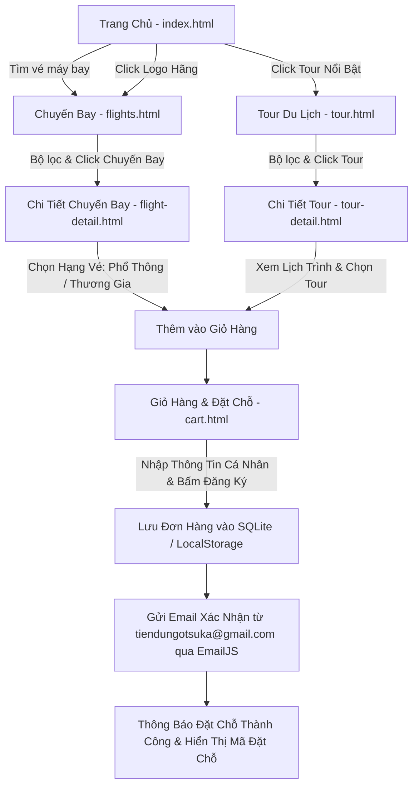

# PRD - TÀI LIỆU YÊU CẦU SẢN PHẨM (PRODUCT REQUIREMENTS DOCUMENT)
## DỰ ÁN: WEBSITE ĐẶT VÉ MÁY BAY & TOUR DU LỊCH VIETJET

---

## 1. TỔNG QUAN DỰ ÁN
* **Tên thương hiệu:** Vietjet Travel & Booking
* **Mục tiêu:** Xây dựng website thương mại điện tử chuyên cung cấp dịch vụ tìm kiếm, tra cứu, đặt vé máy bay và tour du lịch trọn gói trực tuyến.
* **Môi trường & Công nghệ:**
  * **Frontend:** HTML5, CSS3, JavaScript thuần (Vanilla JS ES6+), không sử dụng Framework nặng hay Node.js backend.
  * **Cơ sở dữ liệu:** SQLite chạy trực tiếp trên Client-Side (thông qua thư viện WebAssembly `sql.js` kết hợp lưu trữ `LocalStorage`/`IndexedDB`).
  * **Gửi email thông báo:** Tích hợp EmailJS SDK (gửi tự động từ tài khoản đại diện `tiendungotsuka@gmail.com` tới email người dùng khi hoàn tất đăng ký đơn hàng).
* **Phong cách giao diện:**
  * Tông màu sáng (White / Light mode), hiện đại, sạch sẽ.
  * Màu chủ đạo: Đỏ Vietjet (`#ee1d23`).
  * Màu nhấn hỗ trợ: Vàng kim (`#f8b300` / `#ffc107`), Đen than (`#1e293b`), Xám nhạt viền (`#e2e8f0`).

---

## 2. KIẾN TRÚC LUỒNG NGƯỜI DÙNG (USER FLOW)

---

## 3. ĐẶC TẢ CHI TIẾT TỪNG TRANG & TÍNH NĂNG

### 3.1. Trang Chủ (`index.html`)

#### A. Header & Thanh Điều Hướng (Navigation Bar)
* **Logo:** Logo chữ hoặc biểu tượng máy bay cách điệu Vietjet (`#ee1d23` kết hợp chữ trắng/vàng).
* **Menu liên kết:**
  * Trang chủ (`index.html`)
  * Chuyến bay (`flights.html`)
  * Tour du lịch (`tour.html`)
  * Về chúng tôi / Giới thiệu
  * Giỏ hàng (`cart.html`) với **Badge đếm số lượng mục đã chọn** (cập nhật realtime từ LocalStorage).
* **Nút liên hệ / Hotline:** `1900 1886` hoặc nút hỗ trợ nhanh.

#### B. Khung Tìm Kiếm Chuyến Bay Nhanh (Flight Search Box)
* Nằm ở vị trí trung tâm Hero Banner trực quan.
* **Loại chuyến bay:** Radio button chọn `Khứ hồi` (Round-trip) hoặc `Một chiều` (One-way). Mặc định chọn `Khứ hồi`.
* **Trường nhập liệu:**
  1. *Điểm xuất phát (Điểm đi):* Dropdown/Input gợi ý (Hà Nội - HAN, TP. Hồ Chí Minh - SGN, Đà Nẵng - DAD, Nha Trang - CXR, Phú Quốc - PQC, Singapore - SIN, Bangkok - BKK, Seoul - ICN, Tokyo - NRT...).
  2. *Điểm đến:* Dropdown/Input tương tự (có nút hoán đổi 2 chiều Đi - Đến nhanh).
  3. *Ngày cất cánh (Ngày đi):* Input date (giới hạn tối thiểu là ngày hôm nay).
  4. *Ngày về (Ngày khứ hồi):* Input date (tự động ẩn/mờ đi nếu người dùng chọn `Một chiều`, kiểm tra logic `Ngày về >= Ngày đi`).
  5. *Hành khách:* Chọn số lượng người lớn, trẻ em, em bé.
* **Nút bấm hành động:** Nút `Tìm Kiếm` (Màu đỏ `#ee1d23`, hover đổi màu đỏ thẫm/vàng).
  * **Hành vi:** Khi click, thu thập các tham số URL (`?type=roundtrip&from=SGN&to=HAN&departDate=...&returnDate=...`) và chuyển hướng sang trang `flights.html`.

#### C. Phần Tour Du Lịch Nổi Bật (8 Tour Nổi Bật)
* Tiêu đề: **"Tour Du Lịch Thịnh Hành & Khám Phá Hấp Dẫn"**.
* Hiển thị dạng lưới **Grid 4 cột x 2 hàng** (tổng cộng 8 cards tour du lịch chất lượng cao):
  * **Hình thumbnail:** Tỷ lệ chuẩn `600x400px`, hình ảnh sắc nét về các địa danh nổi tiếng (Đà Nẵng, Phú Quốc, Sapa, Thái Lan, Nhật Bản, Hàn Quốc, Singapore, Châu Âu).
  * **Nhãn hãng hàng không / Đơn vị tổ chức:** Logo nhỏ hoặc text badge (Ví dụ: Vietjet Travel, Vietjet Air, Saigontourist Partner).
  * **Số ngày/đêm:** Badge hiển thị rõ ràng (Ví dụ: `4 ngày 3 đêm`, `5 ngày 4 đêm`, `3 ngày 2 đêm`).
  * **Tên tour:** Tiêu đề tour hấp dẫn, chuẩn SEO.
  * **Giá tour:** Định dạng tiền tệ VND nổi bật (Ví dụ: `3.990.000 ₫`, `7.890.000 ₫`).
  * **Hành vi tương tác:** Click vào card tour sẽ dẫn sang trang `tour-detail.html?id={tour_id}` hoặc `tour.html`.

#### D. Phần Hãng Hàng Không Đối Tác (Airline Partners)
* Tiêu đề: **"Các Hãng Hàng Không Hàng Đầu"**.
* Hiển thị danh sách logo kèm tên các hãng bay lớn (sử dụng các logo có sẵn trong thư mục `Images/`):
  * **VietJet Air** (`Images/vietjet-air.png`)
  * **Vietnam Airlines** (`Images/vietnam-airlines.png`)
  * **Singapore Airlines** (`Images/singapore-airline.png`)
  * **Bamboo Airways**
  * **Thai Airways**
  * **Korean Air**
  * **Emirates**
* **Hành vi tương tác:** Khi người dùng click vào logo một hãng hàng không bất kỳ, hệ thống sẽ chuyển hướng ngay đến trang `flights.html?airline={airline_code}` (lọc tự động các chuyến bay của hãng đó).

#### E. Footer
* Thông tin bản quyền, giấy phép kinh doanh du lịch lữ hành.
* Địa chỉ công ty, email hỗ trợ, hotline chăm sóc khách hàng 24/7.
* Các phương thức thanh toán hỗ trợ (Visa, Mastercard, MoMo, ZaloPay, VietQR).

---

### 3.2. Trang Danh Sách Chuyến Bay (`flights.html`)

#### A. Cột Trái: Bộ Lọc Nâng Cao (Filter Sidebar)
* **Sắp xếp theo giá:**
  * Giá tăng dần (Mặc định).
  * Giá giảm dần.
* **Loại vé:**
  * Tất cả
  * Vé khứ hồi
  * Vé một chiều
* **Hành trình:**
  * Bay thẳng (Direct flight)
  * 1 điểm dừng (Transit)
  * Nhiều thành phố (Multi-city)
* **Hãng hàng không (Checkboxes lọc đa lựa chọn):**
  * [x] VietJet Air
  * [x] Vietnam Airlines
  * [x] Singapore Airlines
  * [x] Bamboo Airways
  * ...
* **Khung giờ cất cánh (Giờ khởi hành):**
  * Sáng sớm (00:00 - 06:00)
  * Buổi sáng (06:00 - 12:00)
  * Buổi chiều (12:00 - 18:00)
  * Buổi tối (18:00 - 24:00)
* **Hạng vé / Dịch vụ:**
  * Hạng Phổ Thông (Economy)
  * Hạng Thương Gia (Business)
* **Nút Reset bộ lọc:** Đưa tất cả tiêu chí về trạng thái ban đầu.

#### B. Cột Phải: Danh Sách Chuyến Bay (Flight Results List)
* Thanh tóm tắt kết quả (Ví dụ: `Hiển thị 18 chuyến bay từ TP. Hồ Chí Minh đi Hà Nội`).
* Mỗi thẻ chuyến bay (Flight Card) bao gồm:
  * **Logo & Tên hãng bay:** Hiển thị rõ logo VietJet Air, Vietnam Airlines... và mã hiệu chuyến bay (VJ-124, VN-216...).
  * **Thời gian & Hành trình:**
    * Giờ cất cánh - Sân bay đi (Ví dụ: `06:30 SGN`).
    * Tổng thời gian bay (Ví dụ: `2h 10m`) kèm vạch chỉ bay thẳng hoặc quá cảnh.
    * Giờ hạ cánh - Sân bay đến (Ví dụ: `08:40 HAN`).
  * **Dịch vụ đi kèm:** Badge thể hiện (Ví dụ: `Hành lý 7kg xách tay`, `Suất ăn nóng`, `Ghế ngả êm ái`, `Giải trí trên máy bay`).
  * **Mức giá hiển thị:** Giá từ thấp nhất (Ví dụ: `1.250.000 ₫ / khách`).
  * **Nút thao tác:** Nút `Chọn chuyến bay` (Màu đỏ `#ee1d23`).
  * **Hành vi:** Click nút sẽ điều hướng sang trang `flight-detail.html?id={flight_id}`.

---

### 3.3. Trang Chi Tiết Chuyến Bay (`flight-detail.html`)

#### A. Thông Tin Tổng Quan Chuyến Bay
* **Điểm đi & Điểm đến:** Tên thành phố, tên sân bay, nhà ga (Terminal).
* **Hãng bay & Mã số hiệu:** Logo hãng, mã chuyến bay (VJ-182).
* **Loại tàu bay:** Hiển thị chi tiết dòng máy bay hiện đại (Boeing 787-9 Dreamliner, Airbus A321neo, Airbus A350-900, Boeing 737 MAX...).
* **Lịch trình bay chi tiết:**
  * Giờ cất cánh, ngày bay, sân bay khởi hành.
  * Thời gian bay dự kiến.
  * Giờ hạ cánh, sân bay điểm đến.

#### B. Bảng Lựa Chọn Hạng Vé (Fare Class Selector)
Thiết kế trực quan dạng 2 cột so sánh song song:
1. **Hạng Phổ Thông (Economy Class):**
   * Giá vé (Ví dụ: `1.450.000 ₫`).
   * Quyền lợi:
     * Hành lý xách tay 7kg tiêu chuẩn.
     * Chọn chỗ ngồi tiêu chuẩn.
     * Đổi vé có tính phí theo quy định hãng.
     * Không hoàn vé.
   * Nút chọn: `Chọn Hạng Phổ Thông`.
2. **Hạng Thương Gia (Business Class):**
   * Giá vé (Ví dụ: `3.850.000 ₫`).
   * Quyền lợi đặc quyền:
     * Hành lý xách tay 14kg + 30kg hành lý ký gửi miễn cước.
     * Phòng chờ thương gia VIP hạng sang tại sân bay.
     * Lối đi ưu tiên tại quầy thủ tục & cửa ra máy bay.
     * Suất ăn nóng cao cấp theo yêu cầu kèm đồ uống phong phú.
     * Miễn phí thay đổi ngày giờ bay.
   * Nút chọn: `Chọn Hạng Thương Gia`.

#### C. Thao Tác Thêm Vào Giỏ Hàng
* Khi người dùng nhấp chọn hạng vé bất kỳ:
  * Thu thập dữ liệu chuyến bay: ID, Hãng bay, Loại tàu bay, Hành trình, Ngày giờ, Hạng vé đã chọn, Giá vé.
  * Lưu vào mảng `cart` trong `LocalStorage` (đồng thời đồng bộ vào SQLite Client DB).
  * Hiển thị Toast thông báo: *"Đã thêm chuyến bay vào giỏ hàng thành công!"*.
  * Tùy chọn chuyển hướng nhanh sang `cart.html` hoặc tiếp tục mua thêm.

---

### 3.4. Trang Danh Sách Tour (`tour.html`)

#### A. Cột Trái: Bộ Lọc Tour (Tour Filter Sidebar)
* **Sắp xếp theo giá:** Giá tăng dần / Giá giảm dần.
* **Hãng hàng không vận chuyển:** VietJet Air, Vietnam Airlines, Bamboo Airways...
* **Thời lượng chuyến đi:**
  * Dưới 3 ngày
  * 3 - 5 ngày
  * Trên 5 ngày
* **Thời gian cất cánh / Khởi hành:** Lọc theo tháng hoặc giờ bay.

#### B. Cột Phải: Danh Sách Tour (Tour Results Grid/List)
* Danh sách các gói tour du lịch hấp dẫn trong và ngoài nước.
* Mỗi Card Tour gồm:
  * Hình ảnh thumbnail `600x400px` sắc nét.
  * Tên tour & Mã tour (Ví dụ: `VJ-TOUR-DN01: Khám phá Đà Nẵng - Hội An - Bà Nà Hills`).
  * Hãng hàng không bay cùng tour.
  * Ngày cất cánh & Thời gian bay.
  * Lịch trình ngắn gọn: `4 Ngày 3 Đêm`.
  * Dịch vụ bao gồm: Khách sạn 4-5 sao, Vé máy bay khứ hồi, Hướng dẫn viên, Vé tham quan trọn gói, Bảo hiểm du lịch.
  * Giá tour trọn gói (VND).
  * Nút `Chi tiết Tour` -> Chuyển sang `tour-detail.html?id={tour_id}`.

---

### 3.5. Trang Chi Tiết Tour (`tour-detail.html`)

#### A. Thông Tin Chi Tiết Tour & Chuyến Bay Đi Kèm
* Điểm xuất phát (Hà Nội / TP.HCM) và Điểm đến tham quan.
* Hãng hàng không phục vụ chặng bay của tour (VietJet Air, v.v.).
* Loại máy bay chuyên chở (Airbus A321 / Boeing 787).
* Tổng thời gian bay và thời lượng tour (Ví dụ: 4 Ngày 3 Đêm).

#### B. Lịch Trình Chuyến Đi Chi Tiết (Tour Itinerary Timeline)
* Thiết kế Accordion hoặc Timeline dạng chuỗi ngày trực quan:
  * **Ngày 1:** Điểm hẹn tại sân bay - Bay đến điểm du lịch - Nhận phòng khách sạn - Khám phá ẩm thực địa phương.
  * **Ngày 2:** Tham quan các danh lam thắng cảnh chính - Hoạt động vui chơi giải trí.
  * **Ngày 3:** Trải nghiệm văn hóa, tắm biển, mua sắm đặc sản.
  * **Ngày 4:** Mua sắm tự do - Ra sân bay làm thủ tục - Chuyến bay về điểm xuất phát.
* **Chính sách tour:** Bao gồm, không bao gồm, điều kiện hủy/đổi tour, thực đơn ăn uống.

#### C. Đặt Tour & Thêm Vào Giỏ Hàng
* Form chọn ngày khởi hành mong muốn, số lượng khách (Người lớn / Trẻ em).
* Tự động tính toán tổng giá trị tour.
* Nút bấm: `Đặt Tour Ngay / Thêm Vào Giỏ Hàng`.
* Dữ liệu được lưu trữ tự động vào Giỏ Hàng (`cart.html`).

---

### 3.6. Trang Giỏ Hàng & Xác Nhận Đăng Ký (`cart.html`)

#### A. Bảng Danh Mục Sản Phẩm Đã Chọn (Cart Items Table)
* Hiển thị bảng phân loại rõ ràng:
  * Vé máy bay đã chọn (Hãng, Ngày bay, Chặng bay, Hạng vé, Đơn giá, Xóa).
  * Tour du lịch đã chọn (Tên tour, Ngày khởi hành, Số lượng khách, Đơn giá, Xóa).
* **Tính năng:**
  * Nút xóa từng mục riêng lẻ (có xác nhận popup).
  * Nút `Xóa toàn bộ giỏ hàng` (Clear Cart).
  * Tự động cập nhật Tổng tiền thanh toán (Total Amount VND) theo thời gian thực.
  * Nếu giỏ hàng trống: Hiển thị icon trống kèm nút *"Tiếp tục tìm kiếm chuyến bay & tour"*.

#### B. Form Thông Tin Cá Nhân Khách Hàng (Customer Checkout Form)
Các trường bắt buộc:
1. **Họ và tên:** Text (Có kiểm tra tính hợp lệ).
2. **Số điện thoại:** Tel (Kiểm tra đúng định dạng số ĐT Việt Nam 10 chữ số).
3. **Địa chỉ Email:** Email (Quan trọng: Dùng để nhận vé điện tử).
4. **Số CCCD / Hộ chiếu:** Text (Bắt buộc cho thủ tục bay).
5. **Yêu cầu đặc biệt / Ghi chú:** Textarea (Ví dụ: Suất ăn chay, ghế ngồi cạnh cửa sổ...).

#### C. Thao Tác Đăng Ký & Gửi Email Tự Động
* Nút bấm: **`XÁC NHẬN ĐĂNG KÝ VÀ ĐẶT VÉ`** (Màu đỏ Vietjet nổi bật).
* **Quy trình xử lý khi nhấn `Đăng ký`:**
  1. **Validate:** Kiểm tra tính đầy đủ của form thông tin cá nhân và giỏ hàng không được rỗng.
  2. **Tạo mã đặt chỗ:** Sinh mã PNR ngẫu nhiên (Ví dụ: `VJ-BK-893247`).
  3. **Lưu dữ liệu:** Lưu bản ghi đơn hàng đầy đủ vào cơ sở dữ liệu SQLite trong trình duyệt (Bảng `bookings` và `booking_items`).
  4. **Gửi email tự động qua EmailJS:**
     * **Người gửi đại diện:** `tiendungotsuka@gmail.com`
     * **Người nhận:** Email của khách hàng vừa nhập trong form.
     * **Tiêu đề email:** `[Vietjet Travel] Xác nhận đặt vé & tour thành công - Mã PNR: {booking_code}`
     * **Nội dung email:** Chi tiết hành trình, danh sách chuyến bay/tour, tổng chi phí, thông tin hành khách và lời cảm ơn từ ban quản trị.
  5. **Thông báo hoàn thành:**
     * Hiển thị Modal/Popup thông báo sang trọng: *"Đặt vé & Tour thành công!"*.
     * Cung cấp Mã đặt chỗ, hướng dẫn thanh toán.
     * Làm rỗng giỏ hàng sau khi đặt thành công.

---

## 4. TIÊU CHUẨN THIẾT KẾ & TRẢI NGHIỆM (UI/UX)
* **Responsive:** Tương thích 100% trên cả Desktop (1920x1080, 1440x900), Laptop, Tablet (iPad), và Điện thoại di động (iPhone/Android).
* **Tốc độ:** Tải trang tức thì, không phụ thuộc server backend nặng nề.
* **Font chữ:** `Roboto` hoặc `Inter`, `Be Vietnam Pro` (tiếng Việt không lỗi font).
* **Màu sắc thương hiệu:**
  * Nền: Trắng sáng (`#ffffff`, `#f8fafc`).
  * Màu thương hiệu chính: Đỏ cờ Vietjet (`#ee1d23`).
  * Màu thương hiệu phụ: Vàng Vietjet (`#f8b300` / `#ffd200`).
  * Text chính: `#0f172a` (Tương phản cao, dễ đọc).
  * Viền & card: `#e2e8f0`.
